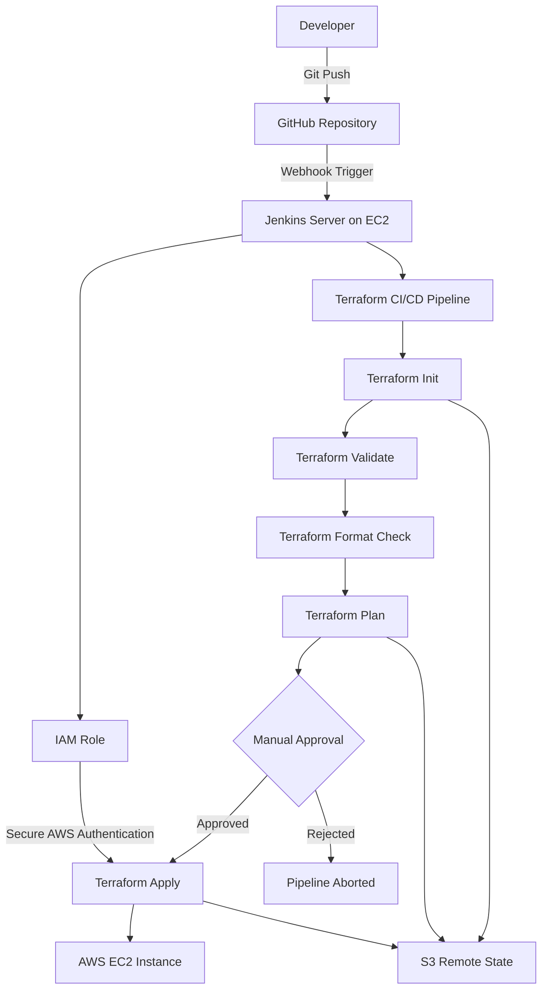

## AWS Infrastructure Provisioning using Terraform & Jenkins CI/CD

### Overview

This project automates AWS infrastructure provisioning using Terraform and Jenkins CI/CD. It integrates GitHub with Jenkins to automatically trigger pipeline execution whenever code changes are pushed to the repository.

The pipeline follows Infrastructure as Code (IaC) best practices by validating Terraform configurations, generating execution plans, and requiring manual approval before applying infrastructure changes.

Infrastructure state is securely stored in an Amazon S3 backend, enabling centralized state management and supporting collaboration.

## Architecture



---

## 🚀 Project Objectives

* Automate AWS infrastructure provisioning using Terraform.
* Implement CI/CD automation using Jenkins.
* Integrate GitHub with Jenkins using webhooks.
* Implement Infrastructure as Code (IaC) best practices.
* Store Terraform state remotely using Amazon S3.
* Use IAM roles for secure AWS authentication.
* Implement manual approval before infrastructure deployment.
* Reduce manual infrastructure provisioning effort.

---

## Project Structure


```text
  AWS-Infra-through-Terraform-with-Jenkins-CICD/
│
├── Jenkinsfile
├── README.md
├── .gitignore
│
└── terraform/
    ├── main.tf
    ├── provider.tf
    ├── variables.tf
    ├── output.tf
    └── .terraform.lock.hcl
```

---

## 🛠️ Technologies Used

* AWS EC2 ---------- Hosting Jenkins and provisioning infrastructure
* AWS IAM ---------- Secure authentication and authorization
* AWS S3  ---------- Remote Terraform state storage
* Terraform -------- Infrastructure as Code
---
