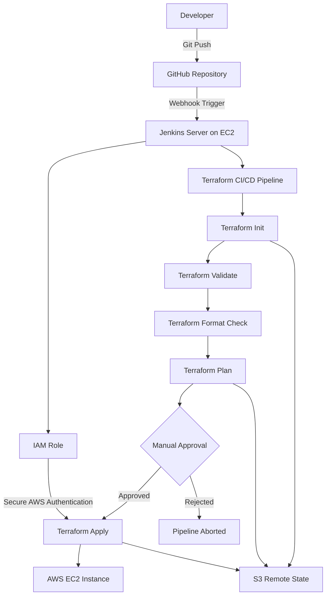

## AWS Infrastructure Provisioning using Terraform & Jenkins CI/CD

### Overview

This project automates AWS infrastructure provisioning using Terraform and Jenkins CI/CD. It integrates GitHub with Jenkins to automatically trigger pipeline execution whenever code changes are pushed to the repository.

The pipeline follows Infrastructure as Code (IaC) best practices by validating Terraform configurations, generating execution plans, and requiring manual approval before applying infrastructure changes.

Infrastructure state is securely stored in an Amazon S3 backend, enabling centralized state management and supporting collaboration.

## Architecture



---

## 🚀 Project Objectives

* Automate AWS infrastructure provisioning using Terraform.
* Implement CI/CD automation using Jenkins.
* Integrate GitHub with Jenkins using webhooks.
* Implement Infrastructure as Code (IaC) best practices.
* Store Terraform state remotely using Amazon S3.
* Use IAM roles for secure AWS authentication.
* Implement manual approval before infrastructure deployment.
* Reduce manual infrastructure provisioning effort.

---

## Project Structure


```text
  AWS-Infra-through-Terraform-with-Jenkins-CICD/
│
├── Terraform-drift-detection
│   ├── Jenkinsfile.drift
├── Jenkinsfile
├── README.md
├── .gitignore
│
└── terraform/
    ├── main.tf
    ├── provider.tf
    ├── variables.tf
    ├── output.tf
    └── .terraform.lock.hcl
```

---

## 🛠️ Technologies Used

* AWS EC2 ---------- Hosting Jenkins and provisioning infrastructure
* AWS IAM ---------- Secure authentication and authorization
* AWS S3  ---------- Remote Terraform state storage
* Terraform -------- Infrastructure as Code
* Jenkins ---------- CI/CD pipeline automation
* GitHub ----------- Source code management
* GitHub Webhooks -- Automated pipeline triggering
* Ubuntu 24.04 ----- Operating system
---

## Infrastructure Provisioned

The project provisions an AWS EC2 instance using Terraform.

#### EC2 Configuration
---
* Cloud Provider: AWS
* Region: ap-south-1 (Mumbai)   // Choose according to your region
* Operating System: Ubuntu 24.04 LTS
* Instance Type: t2.micro
* Provisioning Tool: Terraform
* Resource Management: Infrastructure as Code
---
Terraform dynamically retrieves the latest Ubuntu 24.04 AMI using a data source.


### ⚙️ CI/CD Pipeline Workflow

The Jenkins pipeline automates the Terraform workflow through the following stages:

#### 1. Checkout
Retrieves the source code from the GitHub repository.

#### 2. Terraform Version Check
Verifies the installed Terraform version.

#### 3. AWS Authentication
Validates AWS authentication using the IAM role attached to the Jenkins EC2 instance.
```
aws sts get-caller-identity
```
This eliminates the need to store AWS Access Keys and Secret Keys in Jenkins.

#### 4. Terraform Init
Initializes the Terraform working directory and configures the remote backend.
```
terraform init
```

#### 5. Terraform Validate
Validates the Terraform configuration files for syntax and configuration errors.
```
terraform validate
```

#### 6. Terraform Format Check
Checks whether Terraform configuration files follow standard formatting.
```
terraform fmt -check -recursive
```

#### 7. Terraform Plan
Generates an execution plan to preview infrastructure changes before deployment.
```
terraform plan
```

#### 8. Manual Approval
Jenkins pauses the pipeline and waits for manual approval before proceeding with infrastructure changes.
This provides an additional safety mechanism to review the Terraform plan before applying changes.

#### 9. Terraform Apply
After approval, Terraform applies the previously generated execution plan.
```
terraform apply
```

#### 10. Terraform Outputs
Displays the output values of the provisioned infrastructure, such as:

* EC2 Instance ID
* Public IP Address
* Instance Type

### Security Best Practices Implemented

* AWS authentication using IAM roles instead of hardcoded credentials.
* Least-privilege IAM permissions.
* Terraform remote state stored in Amazon S3.
* S3 bucket versioning enabled.
* S3 public access blocked.
* Infrastructure changes reviewed through Terraform Plan.
* Manual approval before Terraform Apply.
* Sensitive Terraform files excluded from Git using .gitignore.

### Terraform Remote State Management
Terraform state is stored remotely in an Amazon S3 bucket.

#### Backend Configuration
```
backend "s3" {
  bucket       = "**bucket-name**"
  key          = "terraform/terraform.tfstate"
  region       = "***region**"
  use_lockfile = true
}
```

#### Benefits of Remote State

* Centralized state management.
* State accessible across different environments.
* Prevents state loss from local machine failures.
* Supports state locking to prevent concurrent modifications.
* Enables collaboration between team members.

### Prerequisites
Before running the project, ensure the following tools are installed and configured:
* AWS Account
* EC2 instance with Jenkins installed
* Terraform installed on the Jenkins server
* AWS CLI installed
* IAM role attached to the Jenkins EC2 instance
* GitHub repository
* GitHub webhook configured with Jenkins


### Project Setup


